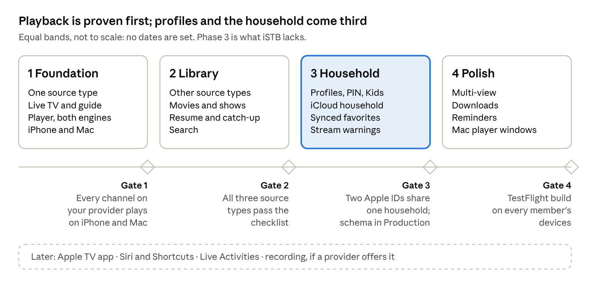

# Hearth — Handoff & Specs

Oct 24, 2026 · Bhavik Jain

Hearth (a working title) is an IPTV player for iPhone, iPad and Mac. It does what iSTB does and adds Netflix-style profiles that a whole household shares through iCloud. It is a concept with mockups and no code yet; this file is the handoff, and the specs sit in the files beside it.

## At a glance

Nothing is built yet: what exists is research, seven mockup screens and these specs. Next comes Phase 1, a player for one provider on iPhone and Mac.

| Item | Detail |
| --- | --- |
| Status | Concept and mockups; no code |
| Platforms | iPhone, iPad and Mac; Apple TV later |
| Sources | Stalker portals (MAC address), Xtream Codes logins, M3U playlists with XMLTV guides |
| What iSTB lacks | Profiles, and a household shared through iCloud with synced favorites and progress |
| Mockups | `ui/index.html` in this package: five iPhone screens, the landscape player and the Mac window |
| Name | Hearth is a working title |

The other files: [Product spec](2-Product-spec.md) lists every requirement with its phase, [Technical spec](3-Technical-spec.md) covers the stores, sync, player and release, and [Source protocols](4-Source-protocols.md) is the reference for the three provider types.

## Decisions made

The big calls are settled; reopen one only with a reason as strong as the one beside it.

| Decision | Choice | Why |
| --- | --- | --- |
| Where it lives | A separate app and repo, not a ninth Multitrack tracker | VLCKit would break Multitrack's zero-remote-dependency rule, and an App Review rejection here would block Multitrack releases |
| Sources | Stalker portals, Xtream Codes and M3U with XMLTV, all three | iSTB supports the same three; the owner's provider decides which ships first |
| Player | AVPlayer for HLS and MP4, VLCKit for everything else | AVPlayer brings picture in picture, AirPlay and Now Playing for free but refuses raw MPEG-TS, which many IPTV streams are |
| Profiles | Kept by the app on top of one provider login | Providers have no profiles; one login or MAC serves the whole household |
| Household | Core Data with NSPersistentCloudKitContainer, one iCloud share per household | The pattern Multitrack already ships for Finance and Trips; no server to run |
| What syncs | Profiles, favorites, progress, rules and sources | Channel lists, guide and posters stay on each device: too big, and they change daily |
| Logins | In the shared store as encrypted attributes | Every member needs them to play; to be proven across a share in Phase 3 |
| Minimum OS | iOS 18 and macOS 15, built with the iOS 26 SDK, Swift 6 | Matches Multitrack, so its Core code carries over |
| Distribution | TestFlight for the household first; the App Store only after a deliberate guideline 5.2 review | Internal TestFlight builds skip App Review |

## Scope

Version 1 is everything iSTB does on iPhone, iPad and Mac, plus profiles and the shared household. Each requirement's phase is in the product spec.

**In version 1**

- All three source types, several per household
- Live TV with categories, a timeline guide and catch-up
- Movies and series with resume and up next
- A player with picture in picture, AirPlay, audio and subtitle tracks, timeshift and multi-view
- Profiles with a PIN, a Kids mode and a Guest mode
- A household shared through iCloud, with favorites and progress synced per profile
- Warnings before a stream would go over the provider's connection limit
- Downloads of movies and episodes where the provider allows them
- A Mac app with a sidebar and multi-view windows

**Later**

- An Apple TV app from the same SwiftUI code
- Siri and Shortcuts, Live Activities for a match in progress
- Recording, only if a provider offers it

**Never**

- Bundled channels, playlists or a directory of providers
- Finding, scanning or sharing portals or logins
- Ads, analytics or tracking
- A server of our own

## Roadmap

No dates are set: each phase starts when the gate before it passes. Every requirement in the Product spec carries its phase.

## Risks

The two that could stop the project are the owner's portal refusing an app that isn't a MAG box, and App Review. Both are checked in the first weeks, before anything else is built on them.

| Risk | What happens | Fallback |
| --- | --- | --- |
| The portal checks a serial number, device ids or a signature | Sign-in fails | Advanced fields for each, filled from the provider; test with the probe in week 1; many providers also issue an Xtream login |
| One stream per MAC | A second member pressing play knocks the first off | Warn before playing; hold several MACs under one portal; buy a second connection |
| App Review rejects under guideline 5.2 | No App Store release | TestFlight for the household; present it as a player that ships no content |
| VLCKit's licence, size and picture in picture | LGPL duties, a larger app, harder PiP | Link it as a dynamic framework with attribution; prefer HLS where the provider offers it |
| Huge catalogs and guides | Slow first load, memory spikes | Parse as a stream, page requests, store in SQLite, import in the background |
| CloudKit sharing traps | Crash at launch or shares that never finish | Follow the Multitrack lessons below; run the schema ritual before each TestFlight build |
| A provider renumbers channels | Favorites and progress point at nothing | Keys built from stable ids with a name fallback (Source protocols, Stable ids) |
| Encrypted logins don't open for share participants | Members can't play | Proven in a Phase 3 spike; fallback is each member typing the login once |

## Open questions

The first one decides what Phase 1 builds; the rest can wait until their phase.

- [ ] Which login does your provider give you: a MAC portal, an Xtream username and password, or an M3U link?
- [ ] How many streams at once does the subscription allow, per login or per MAC?
- [ ] Keep the name Hearth?
- [ ] App Store, or TestFlight only? Internal TestFlight needs each household member added to your App Store Connect team.
- [ ] Who is in the household, and which role does each person get (owner, can manage, can watch)?
- [ ] Are downloads wanted, and does the provider allow them?
- [ ] Apple TV this year, or after the Mac app ships?
- [ ] Copy Multitrack's Core sharing code into the new repo, or extract it into a package both apps use?

## Carried over from Multitrack

Multitrack paid for each of these with a crash, a hang or lost data; Hearth uses the same iCloud stack and starts with them. The full record is Multitrack's [CLAUDE.md](https://github.com/bhavik3jain/bhavik-ios/blob/main/.claude/CLAUDE.md), and its Core package (CloudSharedStore, SharePreparer, CloudSyncMonitor, SharingStatusResolver) is the code to borrow.

- **Model rules or a crash at launch.** Every non-optional attribute has a default, every relationship is optional with an inverse, nothing is unique, and enums are stored as raw strings with a fallback. Breaking one fails at container load, never at compile time.
- **A computed property can't be filtered on.** Predicates and sort descriptors touch stored attributes only, or the fetch fails at runtime.
- **The schema ritual before every TestFlight build that adds an entity or attribute.** Initialise the schema in Development, check it, then Deploy Schema Changes to Production. Production never creates record types itself, including `cloudkit.share`, so the run makes and deletes one test share.
- **Never call the sharing API on the main thread.** Multitrack's TestFlight build 16 deadlocked on Share and was killed. Use background forms, one `share()` per object, look up before sharing, and bound every wait.
- **Members leave a share; they never delete its root.** A participant's delete asks iCloud to delete the owner's record.
- **Don't write what changes every second.** Each synced write wakes the partner's devices and can fire their iCloud alerts. Progress is saved on pause, stop and every few minutes; the who's-watching record is written at play, at stop and every ten minutes, never per second.
- **Debug is its own app.** A `.dev` bundle id with its own container; sharing the release id once crashed TestFlight three times.
- **There is no sync now.** Re-post did-become-active at most once a minute and wait, bounded, for an import; never remove and re-add stores.
- **iOS allows 64 pending local notifications per app.** Guide reminders must fit inside that.
- **Views stay untested by policy.** Logic goes into value types with Swift Testing tests; tests that need a real login are gated so a missing credential shows as a named skip.

## First week

The first week proves the two riskiest things against the real provider: signing in, and playing a channel. Nothing else waits on design.

- [ ] Get answers to the first two open questions: provider type and stream limit.
- [ ] Create the repo with an XcodeGen `project.yml`: iOS and Mac targets, a `.dev` Debug bundle id, one iCloud container.
- [ ] Write the source probe (a Debug launch argument): sign in, list categories, fetch one channel's link, print every step and its timing.
- [ ] Save the provider's responses as test fixtures, logins and MACs scrubbed.
- [ ] Play one live channel through AVPlayer (HLS) and through VLCKit (MPEG-TS), on iPhone and on Mac.
- [ ] Import that provider's whole catalog into the local store and time it.
- [ ] Model the household store from the technical spec now, even though its screens come in Phase 3, and initialise it once in Development.
- [ ] Set up CI: build both platforms and run the package tests.

## Sources

- [iSTB on the App Store](https://apps.apple.com/app/id1497473331) and [iSTB Lite](https://apps.apple.com/app/id1498390886): the product being matched (feature list from its listing, seen through search results)
- [App Review Guidelines](https://developer.apple.com/app-store/review/guidelines/), section 5.2: third-party content and streaming
- [Multitrack's CLAUDE.md](https://github.com/bhavik3jain/bhavik-ios/blob/main/.claude/CLAUDE.md): the CloudKit and sharing lessons
- The mockups: `ui/` in this package, and the live design canvas at https://claude.ai/artifact/FQKiJK9SuC9Xc2UZ8UFQdi
- Protocol sources are listed at the end of [Source protocols](4-Source-protocols.md).
