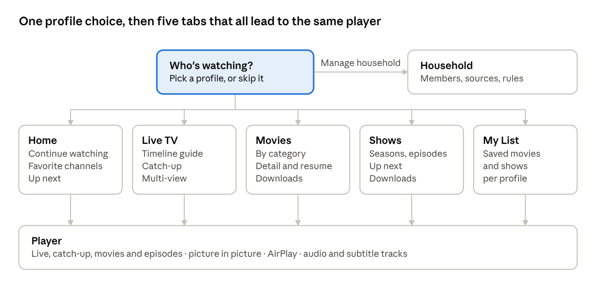

# Product spec

What Hearth does, area by area, with every requirement tagged by the phase that delivers it. Requirement ids (SRC-1, PRF-2 …) stay fixed so issues and commits can cite them.

## Users and roles

Two layers: **members** are iCloud accounts in the household share, and **profiles** are the viewers inside it, so one shared iPad can serve several profiles. Roles are enforced by the app, because every member needs write access in iCloud to save their own favorites and progress.

| Who | What they are | Can |
| --- | --- | --- |
| Owner | The member who created the household | Everything: members, sources, profiles, rules, PIN resets |
| Can manage | A member trusted with setup | Add and edit sources and profiles, change rules; not remove the owner |
| Can watch | Any other member | Pick a profile, watch, edit that profile's favorites and lists; never see logins or change sources |
| Kids profile | A viewer, not an account | Only the categories allowed for kids; an adult's PIN to leave |
| Guest profile | A viewer, not an account | Watch anything not hidden; nothing is saved |

## Navigation

On the Mac the same five places sit in a sidebar under the profile switcher (MAC-1). The mockups in `ui/` show Who's watching, Home, the Live TV guide, a show, Household, the player and the Mac window.

## Sources

A source is one provider login, added once for the whole household. Stalker is planned for Phase 1; if the owner's provider turns out to be Xtream, swap SRC-1 and SRC-2.

| Id | Requirement | Phase |
| --- | --- | --- |
| SRC-1 | Add a Stalker portal: portal URL and MAC address; advanced fields for serial number, device id, device id 2, signature, box model and time zone | Phase 1 |
| SRC-2 | Add an Xtream login: server URL, username, password; show expiry and the connection limit from the account call | Phase 2 |
| SRC-3 | Add an M3U playlist by URL or file, with an XMLTV guide URL taken from the playlist header or typed in | Phase 2 |
| SRC-4 | Test a source before saving it: sign in, count channels and movies, show the provider's own error text on failure | Phase 1 |
| SRC-5 | Show each source's status: active or expired, expiry date, last refresh, streams allowed | Phase 1 |
| SRC-6 | Refresh on demand and on a schedule: catalog daily, guide every few hours | Phase 1 |
| SRC-7 | Several sources per household; their content appears together, each item labelled with its source | Phase 2 |
| SRC-8 | Only the owner and managers see or edit logins; watchers see a source's name | Phase 3 |
| SRC-9 | Removing a source hides its favorites and progress instead of deleting them, so adding it back restores them | Phase 3 |
| SRC-10 | Several MACs under one portal, each device taking a free one | Phase 4 |

## Profiles

Profiles work like Netflix's. Phase 1 ships with one built-in profile so favorites already belong to a profile; the screens to manage them arrive in Phase 3.

| Id | Requirement | Phase |
| --- | --- | --- |
| PRF-1 | Up to 8 profiles per household, each with a name, an avatar (colour plus letter or symbol) and a kind: standard, kids or guest | Phase 3 |
| PRF-2 | "Who's watching?" at launch when there is more than one profile; a device can be set to always open one profile | Phase 3 |
| PRF-3 | An optional 4-digit PIN per profile, asked when switching to it | Phase 3 |
| PRF-4 | Kids: only categories the owner marked for kids, no settings, an adult's PIN to leave | Phase 3 |
| PRF-5 | Guest: no history, favorites or progress kept, cleared on leaving | Phase 3 |
| PRF-6 | Per-profile rules: which sources and categories show, and which are hidden | Phase 3 |
| PRF-7 | Each profile has its own favorites, My List, progress, recent channels and up next | Phase 3 |
| PRF-8 | Switch profile from Home's header on the phone and the sidebar on the Mac | Phase 3 |
| PRF-9 | The last profile used on a device is remembered on that device only, never synced | Phase 3 |

## Household sharing

The household is one iCloud share: whoever accepts it gets every profile and source on every device signed in to their Apple ID. The Household screen in the mockups is the reference layout.

| Id | Requirement | Phase |
| --- | --- | --- |
| HH-1 | The first launch creates a household ("<surname> Household"); it exists even while unshared | Phase 3 |
| HH-2 | Invite through the iCloud share sheet (Messages, Mail or a link) and pick a role: can manage or can watch | Phase 3 |
| HH-3 | An accepted invite shows the household's profiles and sources on all of that person's devices | Phase 3 |
| HH-4 | A member can leave and the owner can remove one; leaving clears the household from that member's devices only | Phase 3 |
| HH-5 | Who's watching now: each active stream (person, device, channel, source) visible to the household within about a minute | Phase 3 |
| HH-6 | Before playing on a source at its limit, warn and name who is using it; "Watch anyway" stays possible | Phase 3 |
| HH-7 | Sources and profiles belong to the household; favorites, lists and progress belong to a profile | Phase 3 |

## Live TV and guide

Live TV opens on the profile's favorites. The guide is a timeline, and anything already aired on a channel with an archive can be watched from its start.

| Id | Requirement | Phase |
| --- | --- | --- |
| LIV-1 | Channel list by category: number, logo, what's on now and its progress; Favorites first | Phase 1 |
| LIV-2 | Timeline guide: channels down, time across, a now line, two hours on screen, as many days back and ahead as the guide holds | Phase 1 |
| LIV-3 | Tap a programme for its details and Watch live | Phase 1 |
| LIV-4 | Catch-up: aired programmes carry a mark when the channel has an archive; play from the start or any point | Phase 2 |
| LIV-5 | In the player: channel up and down, previous channel, a mini guide over the picture | Phase 1 |
| LIV-6 | Find a channel by name or number | Phase 1 |
| LIV-7 | A missing logo falls back to a monogram tile | Phase 1 |
| LIV-8 | Hide channels and categories per profile | Phase 3 |
| LIV-9 | Remind me: a local notification a few minutes before a programme starts | Phase 4 |

## Movies and Shows

Movies and shows come from the providers' on-demand catalogs, merged across sources. Home pulls the most useful of them together for the current profile.

| Id | Requirement | Phase |
| --- | --- | --- |
| HOME-1 | Home: Continue watching, favorite channels with what's on, up next in shows, new movies | Phase 2 |
| VOD-1 | Movies by category, sorted by date added, name or year, as a poster grid | Phase 2 |
| VOD-2 | Movie detail with whatever the provider supplies (poster, year, plot, rating, cast, length), plus Play or Resume, My List and Download | Phase 2 |
| VOD-3 | Resume from the last position per profile; marked watched at 95% | Phase 2 |
| SER-1 | Shows by category; detail with seasons and episodes, each episode's watched mark and progress | Phase 2 |
| SER-2 | Up next: the next unwatched episode of each show in progress, per profile | Phase 2 |
| SER-3 | Show where other profiles in the household are in a show (never a Guest's) | Phase 3 |
| DL-1 | Download a movie or episode to watch offline, when it is a file rather than a live stream; kept on that device only | Phase 4 |
| DL-2 | A download counts against the provider's stream limit while it runs | Phase 4 |

## Player

One player screen serves live TV, catch-up, movies and episodes; the engine underneath is chosen per stream (Technical spec). The landscape player in the mockups is the reference.

| Id | Requirement | Phase |
| --- | --- | --- |
| PLY-1 | Play HLS and MP4 with AVPlayer and everything else (raw MPEG-TS, MKV) with VLCKit, chosen automatically | Phase 1 |
| PLY-2 | Controls: play and pause, back and forward 10 seconds, scrubbing, Jump to live | Phase 1 |
| PLY-3 | Picture in picture and AirPlay for streams AVPlayer plays; Now Playing and lock-screen controls; audio keeps playing in the background | Phase 1 |
| PLY-4 | On failure, show the provider's message, retry once with a fresh link, then offer the same channel from another source if one exists | Phase 1 |
| PLY-5 | Pause and rewind live TV within the channel's catch-up window | Phase 2 |
| PLY-6 | Choose audio and subtitle tracks; each profile's preferred languages picked automatically | Phase 2 |
| PLY-7 | Fit, fill and zoom | Phase 2 |
| PLY-8 | Picture in picture for streams VLCKit plays | Phase 4 |
| PLY-9 | Multi-view: two or four streams, one with sound; a slot the stream limits rule out says why | Phase 4 |
| PLY-10 | Sleep timer | Later |

## Favorites, My List and search

Favorites and My List belong to a profile and follow it to every device in the household. Search runs on the device against the local catalog, across every source.

| Id | Requirement | Phase |
| --- | --- | --- |
| FAV-1 | Favorite channels, in an order set by hand | Phase 1 |
| FAV-2 | Favorites survive channel renumbering and source refreshes (stable keys, Source protocols) | Phase 1 |
| FAV-3 | My List for movies and shows | Phase 2 |
| FAV-4 | Favorites, My List and progress synced per profile through the household | Phase 3 |
| SRCH-1 | One search across channels, the next 24 hours of the guide, movies and shows, from all sources | Phase 2 |
| SRCH-2 | Results grouped by type; nothing leaves the device | Phase 2 |
| SRCH-3 | A Kids profile's results include only what it may watch | Phase 3 |

## Parental controls and privacy

Adult content is hidden everywhere until the owner says otherwise. Nothing leaves the device except calls to the household's own providers and to iCloud.

| Id | Requirement | Phase |
| --- | --- | --- |
| PRIV-1 | No analytics, ads or tracking libraries | Phase 1 |
| PRIV-2 | Logins are never logged, and are scrubbed from probe output and test fixtures | Phase 1 |
| PRIV-3 | Logins stay encrypted in iCloud yet open on every member's devices | Phase 3 |
| PAR-1 | Adult categories hidden on every profile by default, matched by name ("adult", "xxx", "18+") plus any the owner marks | Phase 3 |
| PAR-2 | Kids profiles see only the categories allowed for them | Phase 3 |
| PAR-3 | PINs stored as salted hashes; the owner can reset a forgotten one | Phase 3 |
| PAR-4 | A Guest profile keeps nothing | Phase 3 |

## Mac app

The Mac app shows the same household with a sidebar instead of tabs, and uses the bigger screen for multi-view and separate player windows. The Mac window in the mockups is the reference.

| Id | Requirement | Phase |
| --- | --- | --- |
| MAC-1 | A split view: the profile switcher, search, Home, Live TV, Movies, Shows, My List, Downloads, then favorite channels, and the household's stream use at the foot | Phase 1 |
| MAC-2 | Keyboard: space to pause, left and right arrows for 10 seconds, up and down for channels, ⌘F for full screen | Phase 1 |
| MAC-3 | Players in their own windows, several at once, each able to go full screen | Phase 4 |
| MAC-4 | Settings as its own window (⌘,) | Phase 1 |
| MAC-5 | Multi-view in Live TV's toolbar, with a channel dragged from the sidebar onto a tile | Phase 4 |
| MAC-6 | iPad uses the Mac's sidebar layout when the window is wide enough | Phase 2 |

## Quality bar

These are targets to confirm against the owner's real provider in Phase 1, not measurements. A miss is a bug to fix or a target to change on purpose.

| Area | Target |
| --- | --- |
| Starting a live channel | Picture within 2 s on home Wi-Fi for HLS, 3 s for MPEG-TS |
| Switching channel | Under 2 s from press to picture |
| Guide | Scrolls without dropped frames with 1,000 channels loaded |
| First import | 50,000 movies and series stored in under 2 minutes, in the background, with the app usable throughout |
| Opening the app | Last-used screen from the local catalog in under 1 s, with no network |
| Offline | The app opens, downloads play, and a provider it can't reach says so plainly |
| Accessibility | VoiceOver labels on every control, Dynamic Type, 44 pt touch targets, captions follow system settings, Reduce Motion respected |
| Languages | English first; every string localisable from day one |
