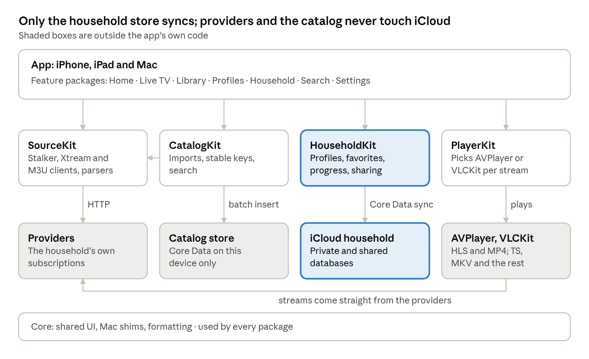
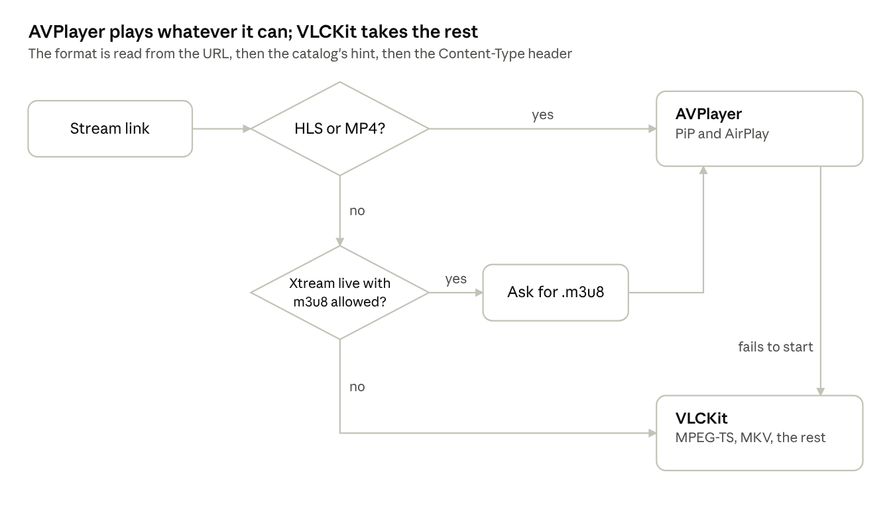

# Technical spec

Hearth is a separate SwiftUI app for iOS 18 and macOS 15, built with the iOS 26 SDK. It keeps two stores, a household shared through iCloud and a catalog cached on each device, and its player picks AVPlayer or VLCKit for each stream.

## Architecture

CatalogKit pulls through SourceKit and writes the local store; only HouseholdKit talks to iCloud. The player takes its stream URLs from the catalog and plays them straight from the provider.

## Packages and targets

The repo copies Multitrack's layout: an XcodeGen `project.yml`, an `App/` composition root with iOS and Mac targets, and local Swift packages. VLCKit is the only remote dependency, and only PlayerKit imports it.

| Package | Owns | Depends on |
| --- | --- | --- |
| Core | Shared UI chrome, the Mac shims, formatting, `counted(_:_:plural:)` | Nothing |
| SourceKit | The Stalker and Xtream clients, the M3U and XMLTV parsers, one `SourceClient` protocol over all three | Nothing |
| CatalogKit | The per-device catalog store, imports from SourceKit, stable keys, search | Core, SourceKit |
| HouseholdKit | The synced household store, sharing, roles, the who's-watching records | Core |
| PlayerKit | The engine protocol, the AVPlayer and VLCKit engines, engine choice, picture in picture, Now Playing, multi-view | Core, VLCKit |
| Feature packages | Home, Live TV, Library (movies and shows), Profiles, Household, Search, Settings | Core plus the kits they need; never each other |

- **Targets:** Hearth (iOS and iPadOS), Hearth-macOS, a test target per package, and an `AllPackageTests` scheme that CI runs.
- **Bundle ids:** a release id and a `.dev` Debug id, each with its own sandbox; both use one iCloud container, Debug against Development only.
- **Rule:** SourceKit and CatalogKit never touch iCloud; HouseholdKit never talks to a provider; features join them.

## Household store

A hand-built Core Data model, `HouseholdModel`, in an NSPersistentCloudKitContainer with a private and a shared store, the way Multitrack's Finance is built. `Household` is the share root; everything else hangs off it. Every non-optional attribute has a default, every relationship is optional with an inverse, nothing is unique, and enums are stored as `…Raw` strings.

| Entity | Attributes | Notes |
| --- | --- | --- |
| Household | id, name, createdAt, adultCategoryKeys (JSON) | Share root; to-many sources, profiles, memberRoles, playbacks |
| Source | id, name, kindRaw (stalker, xtream, m3u), serverURL, sortOrder, isRemoved, maxStreams, expiresAt; encrypted: macAddress, username, password, playlistURL, guideURL, serialNumber, deviceID, deviceID2, signature, model, timeZone | Encrypted attributes use Allows Cloud Encryption, set before the first Production deploy because it can't be added later |
| Profile | id, name, kindRaw (standard, kids, guest), avatarColorRaw, avatarSymbol, sortOrder, pinHash, pinSalt, allowedCategoryKeys (JSON), hiddenCategoryKeys (JSON), audioLanguage, subtitleLanguage | Guest profiles never write favorites or progress |
| Favorite | id, itemKey, kindRaw (channel, movie, series), sortOrder (Double), addedAt | Belongs to a profile; covers favorite channels and My List; duplicates folded by profile plus itemKey |
| Progress | id, itemKey, kindRaw (movie, episode, catchup), position, duration, watched, updatedAt, seriesKey, season, episode | One row per profile and item, updated in place; the later updatedAt wins a conflict |
| Playback | id, deviceName, profileID, sourceID, itemKey, title, startedAt, lastSeenAt | Who's watching now; deleted at stop, ignored after 15 minutes without a heartbeat |
| MemberRole | participantID, roleRaw (owner, manage, watch) | Written only by the owner; the app hides controls by role |

Item keys are built by CatalogKit from stable provider ids, so a refresh or a renumbered channel doesn't orphan a favorite (Source protocols, Stable ids).

## Catalog store

A local Core Data store on each device, never synced and safe to delete: everything in it can be fetched again from the providers. Imports use `NSBatchInsertRequest` into a new generation number, swap when complete, then delete the old generation, so a failed refresh leaves the last good catalog in place.

| Entity | Attributes | Notes |
| --- | --- | --- |
| Category | sourceID, remoteID, kindRaw (live, vod, series), name, sortOrder, isAdult | isAdult matched by name, plus the household's own list |
| Channel | sourceID, remoteID, stableKey, number, name, searchKey, logoURL, categoryID, guideChannelID, hasArchive, archiveDays, command, formatHint | command is Stalker's `cmd` or an Xtream or M3U URL |
| Programme | sourceID, guideChannelID, start, end, title, summary, category, hasArchive | Indexed on guideChannelID and start; kept from 7 days back to 7 ahead |
| Movie | sourceID, remoteID, stableKey, name, searchKey, categoryID, posterURL, year, plot, rating, duration, containerExtension, addedAt | |
| Series | sourceID, remoteID, stableKey, name, searchKey, categoryID, posterURL, plot, year | |
| Episode | sourceID, seriesID, remoteID, stableKey, season, number, title, duration, containerExtension, command | Fetched when a series is opened, then cached |
| SourceState | sourceID, generation, catalogRefreshedAt, guideRefreshedAt, accountExpiry, streamLimit, activeStreams, activeStreamsReadAt | Stalker's session token stays in memory and this device's Keychain, never here |
| Download | itemKey, profileID, fileName, bytes, state, finishedAt | Files in Application Support; one device only |

- **Search** matches a `searchKey` (lowercased, accents and punctuation stripped). If 50,000 movies can't be searched as you type, move to an SQLite FTS table; check in Phase 2.
- **Images** go through `URLCache` with a disk limit, never into either store.

## Sync and sharing rules

Only the household store syncs, and it is written as rarely as the features allow: each write wakes every household device. The share is created through a SharePreparer-style plan, never by a bare `share()` call on the main thread.

| Record | Written when | Conflict rule |
| --- | --- | --- |
| Source, Profile, MemberRole | On save in their editors | Last save wins per attribute |
| Favorite | On add, remove or reorder | Duplicates folded on import by profile plus itemKey, keeping the earliest addedAt |
| Progress | On pause, stop, finish, going to the background, and every 5 minutes of playback | The later updatedAt wins, whole row |
| Playback | At play, at stop, and every 10 minutes while playing | Any device deletes rows unseen for 15 minutes |

- **Sharing:** the owner's first invite shares the `Household` root. Participants join with read and write access, because they save their own favorites and progress; role limits are the app's, not iCloud's.
- **Leaving:** a participant leaves by purging the share's zone from the shared store, never by deleting the root.
- **Logins:** encrypted attributes only; never in UserDefaults, logs or crash reports. A Phase 3 spike proves a participant can read them.
- **Pushes:** `aps-environment` and the remote-notification background mode on, so a partner's favorite lands in seconds rather than at the next launch.
- **No iCloud alert subscriptions** in version 1: nothing needs to reach a device that is off.
- **Refresh from iCloud:** Multitrack's CloudSyncMonitor approach, at most once a minute, with a bounded wait.

## Player engine

One `PlaybackEngine` protocol (load, play, pause, seek, tracks, state) hides which engine runs, so the player screen and multi-view never ask. An AVPlayer stream that hasn't started within a few seconds, or fails, is retried once on VLCKit with a fresh link.

| | AVPlayer | VLCKit |
| --- | --- | --- |
| Formats | HLS, MP4, MOV | MPEG-TS, MKV and most others, HLS too |
| Picture in picture | Built in | Phase 4 (PLY-8), through a sample-buffer layer |
| AirPlay video | Built in | Screen mirroring only |
| Now Playing, lock screen | Set by the app | Set by the app |
| Audio and subtitle tracks | Media selection groups | VLCKit's track lists |
| Mac | Yes | Yes |

## Stream limits

The provider's own count wins wherever it gives one; the household's Playback records only say who is using the streams. Xtream reports a count, Stalker and M3U don't.

| Source | Limit from | In use from |
| --- | --- | --- |
| Xtream | `max_connections` in the account call | `active_cons` in the same call, read when Live TV opens and before each play |
| Stalker | The owner's setting, 1 per MAC by default | Playback records on that source |
| M3U | The owner's setting, unlimited by default | Playback records on that source |

1. Before playing, free = limit minus streams in use, not counting this device's own stream.
2. Free above zero: play.
3. Free at zero: a sheet names who is watching what, with Watch anyway, Use another source (when the same channel exists elsewhere) and Cancel.
4. Multi-view takes one stream per tile; a tile that can't get one says which source is full.
5. A running download takes a stream until it finishes or pauses.

## Catalog refresh and the guide

Catalogs refresh daily and guides every 6 hours, one source at a time, in the background and cancellable. The exact calls per source are in Source protocols.

| What | When | How |
| --- | --- | --- |
| Account (expiry, streams) | On adding a source, when Live TV opens, before each play on Xtream | One call |
| Channels and categories | On adding a source, then when the app opens if older than 24 h | Stalker `get_genres` + `get_all_channels`; Xtream live categories and streams; the M3U file |
| Movies and series lists | Same as channels | Stalker paged `get_ordered_list` (pages count from 0); Xtream VOD and series calls |
| Episodes | When a series is opened | Stalker series list by `movie_id` and `season_id`; Xtream `get_series_info` |
| Guide | Every 6 hours, and in an iOS background refresh when the system allows | XMLTV where offered (Xtream `xmltv.php`, the playlist's guide URL), read as a stream; Stalker's short guide for the channels on screen |

- **Big files:** M3U files are read line by line and XMLTV with a streaming `XMLParser`; gzip goes through the system zlib, never a remote package.
- **Background task:** register the iOS refresh task in the app's init with its identifier in `BGTaskSchedulerPermittedIdentifiers`, and keep its callbacks `@Sendable`; Multitrack's TV refresh hit both traps.
- **Time zones:** XMLTV times carry their offset; Stalker guide times are read in the portal's `timezone`; a test pins each case.

## Testing

Swift Testing only, as in Multitrack: logic lives in value types and is tested, views are not. No test touches iCloud or a real provider unless it is gated on a credential and skips by name without one.

| Package | What the tests pin |
| --- | --- |
| SourceKit | Parsing of saved responses per source type: sign-in, `js` as an array or as `data`, 0-based pages, the link inside `create_link`'s `cmd`, base64 guide titles, M3U attributes, XMLTV times. Network faked with a `URLProtocol` stub |
| CatalogKit | Imports of fixture catalogs into an in-memory store, generation swap, stable keys, search normalisation |
| HouseholdKit | In-memory Core Data: progress conflict rule, favorite folding, role checks, stale Playback cleanup |
| PlayerKit | The engine choice table: URL, extension and content type to engine |

**Debug launch arguments**, all `#if DEBUG`:

- `-SourceProbe <source name>`: sign in to a real provider, list categories, fetch one link, print each step with timings, logins masked.
- `-StubProvider YES`: a fake provider behind `URLProtocol`, so a simulator shows channels, a guide and movies with no login.
- `-InMemoryStores YES`: both stores in memory, no iCloud.
- `-InitializeCloudKitSchema YES`: the schema ritual run, as in Multitrack.

**CI:** a GitHub Actions macOS runner builds both platforms and runs `AllPackageTests` on a simulator. It holds no provider credentials.

## Build, release and App Review

The household gets builds through internal TestFlight, which skips App Review; an App Store release waits for a deliberate answer to guideline 5.2. The build and signing setup copies Multitrack's.

- **Project:** XcodeGen; the generated `.xcodeproj` is gitignored; signing, entitlements and Info.plist keys live in `project.yml`.
- **Build number:** the CI run number plus an offset, passed on the archive command line, as in Multitrack.
- **Entitlements:** CloudKit with one container, push (`aps-environment`), background modes for audio, fetch and remote notifications; on the Mac, the sandbox plus outgoing network.
- **Plain-HTTP providers:** many portals and playlists are `http://`, and their addresses are typed by the user, so App Transport Security needs `NSAllowsArbitraryLoads`. App Review asks for a reason; the reason is user-supplied servers.
- **VLCKit:** pinned to an exact version and linked as a dynamic framework. It is LGPL (check the version pinned): the licence and a source offer go in Settings, Acknowledgements.
- **TestFlight:** internal testers must be users on the App Store Connect team, up to 100; external testers go through Beta App Review.

**Guideline 5.2**, as Apple words it:

- 5.2.2: "If your app uses, accesses, monetizes access to, or displays content from a third-party service, ensure that you are specifically permitted to do so under the service's terms of use. Authorization must be provided upon request."
- 5.2.3: "Apps should not facilitate illegal file sharing or include the ability to save, convert, or download media from third-party sources … without explicit authorization from those sources. Streaming of audio/video content may also violate Terms of Use, so be sure to check before your app accesses those services."

For a public release: ship no channels, playlists or provider lists; give reviewers a demo playlist of streams that are free to use, such as Apple's own HLS samples; say in the review notes that the app only plays services the user already subscribes to. Downloads (DL-1) are the feature 5.2.3 names most directly, so they are the first thing to drop if review objects.
